# GateKeeper

Android app for classroom attendance and smart-door access, built as a university project. It combines QR-code attendance sessions, a local SQLite database, and an ESP32/Bluetooth door controller.

This repo is set up so you can clone it and actually run it — you don't need my Firebase project or a physical ESP32 to see it work. It boots straight into a working demo with sample data already loaded.

[Demo](#demo) · [Screenshots](#screenshots) · [Architecture](#architecture) · [Tech stack](#tech-stack) · [Security note](#security-note) · [Contributing](CONTRIBUTING.md) · [Security policy](SECURITY.md)

## Demo

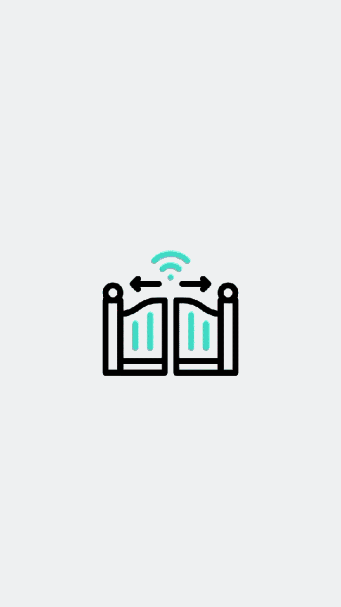

## Screenshots

**Teacher**

| Home | Rooms today | Notifications |
|---|---|---|
| 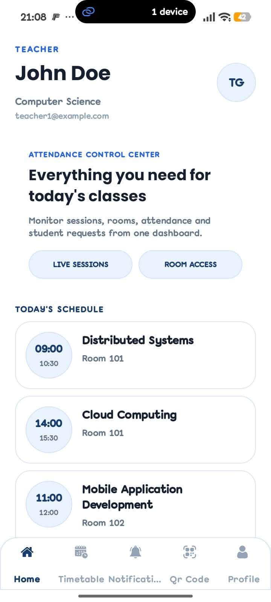 | 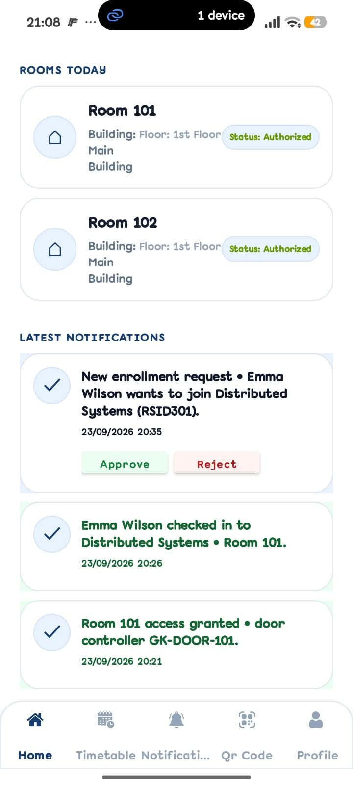 | 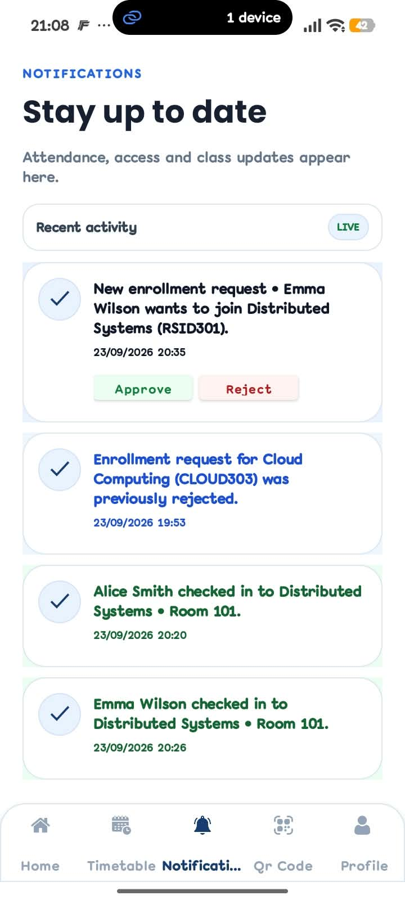 |

| Session QR code | Attendance records | Profile |
|---|---|---|
| 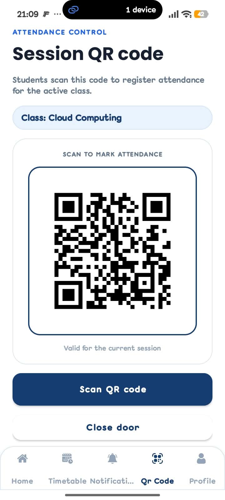 | 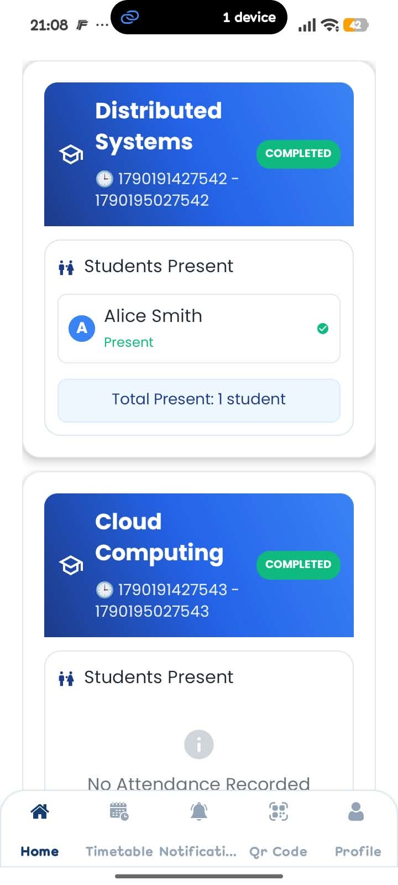 | 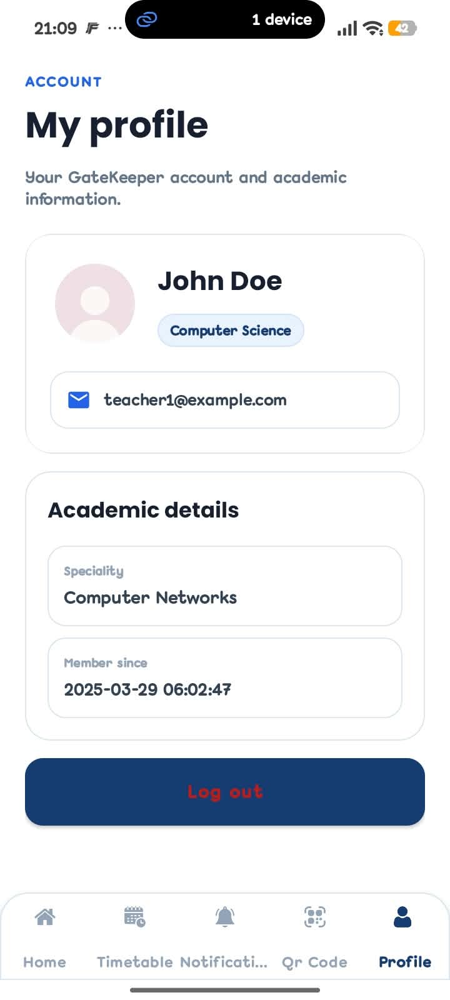 |

**Student**

| Home | Rooms and activity | Timetable | Scan QR |
|---|---|---|---|
| 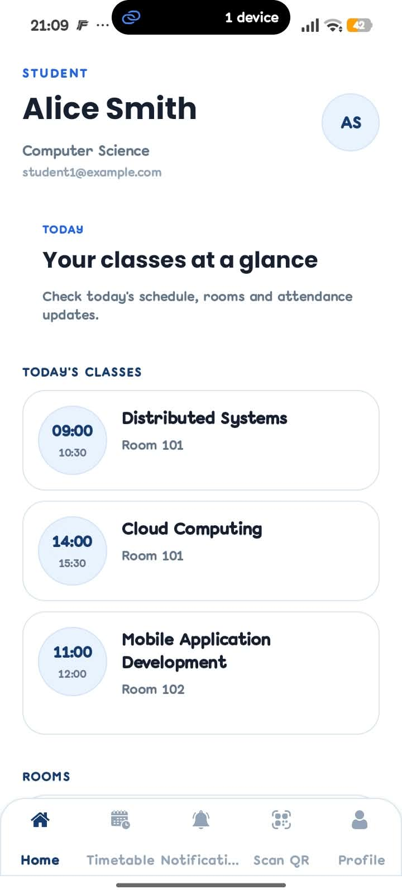 | 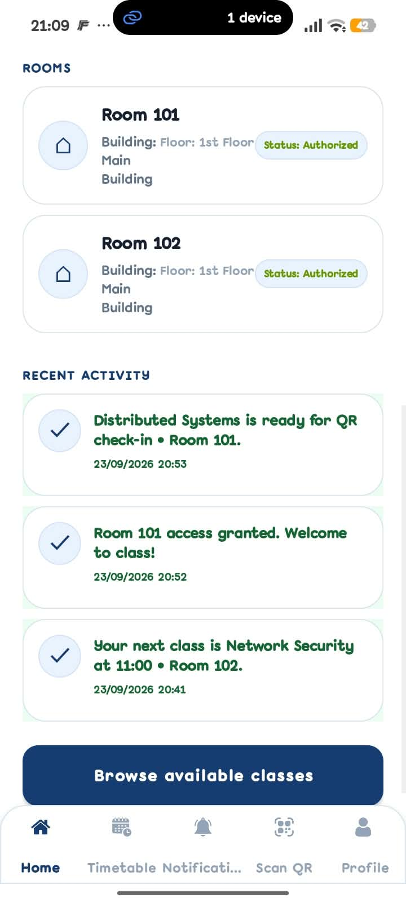 | 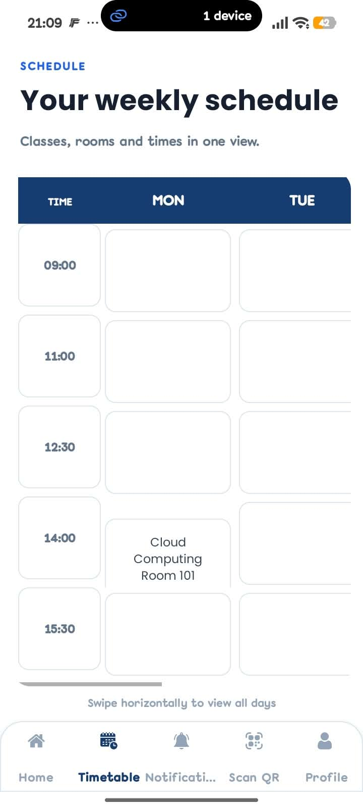 | 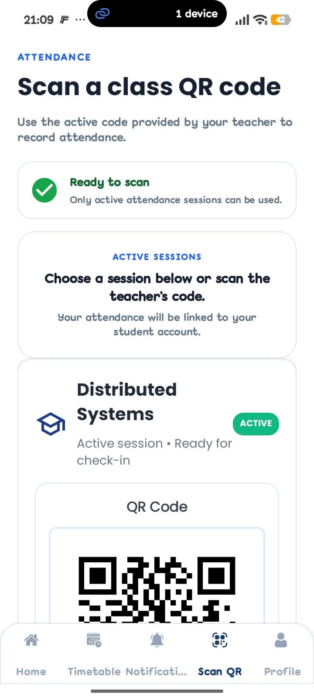 |

**Login**

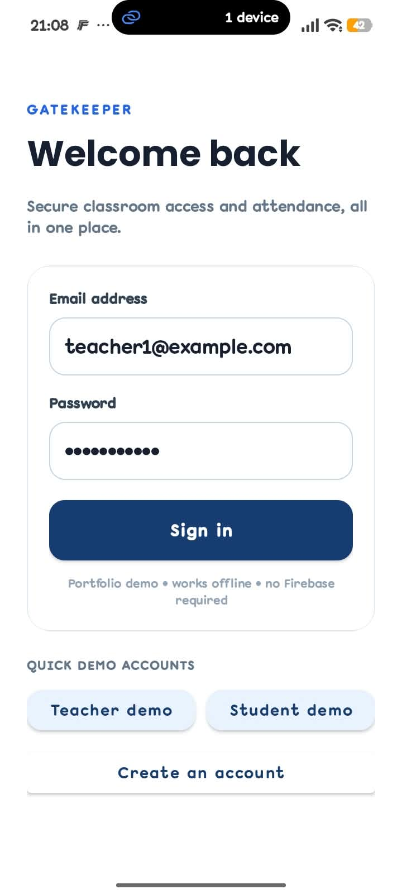

## Portfolio demo

By default the app runs in Demo Mode, which means:

- no Firebase project needed
- no internet needed once Gradle has pulled its dependencies
- no ESP32 or Bluetooth hardware needed
- a bundled SQLite database already seeded with realistic data
- one-tap Teacher and Student demo logins

Everything is explorable from there — dashboards, attendance, timetable, notifications, profile, QR flows. Door actions are simulated and clearly labeled `Demo:` so it's obvious nothing physical is happening. The real Firebase/ESP32 integration code is still in the project; it's just switched off for the public build.

### Demo accounts

| Role | Email | Password |
|---|---|---|
| Teacher | `teacher1@example.com` | `password123` |
| Student | `student1@example.com` | `password123` |

The login screen preloads the teacher account, and there are Teacher Demo / Student Demo buttons for jumping between the two. These credentials are fake and local — obviously don't reuse them anywhere real.

## What it does

**Teacher side** — view your teaching schedule and rooms, start attendance sessions with a generated QR, review who showed up, get notifications, simulate locking/unlocking a door.

**Student side** — check your timetable and enrolled classes, scan the QR to mark attendance, see notifications, view your profile.

## Tech stack

| Area | Technology |
|---|---|
| Platform | Android |
| Language | Java 8 |
| Build | Gradle 8.7 + Android Gradle Plugin 8.5 |
| Android SDK | compile/target 34, min 24 |
| UI | Material Components, ConstraintLayout, RecyclerView |
| Navigation | Fragments + BottomNavigationView |
| Local data | SQLite |
| QR | ZXing |
| Animations | Lottie |
| Images | Glide |
| Hardware extension | ESP32 + Bluetooth Classic (RFCOMM/SPP) |
| Cloud extension | Firebase Auth / Firestore / Realtime Database |

## Run the demo

### Requirements

- Android Studio with Android SDK 34
- JDK 17
- Android phone or emulator

### 1. Clone

```bash
git clone https://github.com/SDStiwi/GateKeeper.git
cd GateKeeper
```

### 2. Open in Android Studio

Open the `GateKeeper` folder and let Gradle sync.

### 3. Run

Hit Run and install the debug APK. No `google-services.json` needed for the default demo build.

### 4. Poke around

1. Wait for the splash screen.
2. Login opens automatically.
3. Tap Teacher Demo or Student Demo.
4. Tap Login.
5. Explore the bottom navigation.
6. As the teacher, open Attendance and try the door/QR flow.
7. Use Profile → Logout to switch roles.

## Demo data

The seeded database ships at:

```text
app/src/main/assets/SmartClassroom.db
```

It has sample users, rooms, classes, sessions, and the attendance tables that go with them — enough state that the app feels lived-in on first launch instead of empty.

## Firebase integration

The original project has Firebase helpers for auth, Firestore, Realtime Database, and local-to-cloud sync. Cloud sync is disabled by default here so nobody needs access to my private Firebase project just to try the app.

If you want to turn this into an actual deployed cloud version, wire up your own Firebase project and auth/database rules — `app/google-services.json.example` is the template for that. Just don't commit a real service-account key or any other secret.

## Security note

**Status: academic prototype; not production-ready. Do not connect this version to real doors or use real personal data.** See [SECURITY.md](SECURITY.md) for the reporting policy and deployment considerations.

The local demo auth is intentionally simple: passwords are stored and compared in plaintext in SQLite, purely so the portfolio build is reproducible without setup. This is not how you'd do auth in anything real, and I wouldn't ship it that way.

This is an academic prototype, not a production access-control system. Things I'd change before this went anywhere near real doors:

- swap the plaintext password model for Firebase Auth or proper hashing
- add role-based Firebase security rules
- replace the unauthenticated `LOCK` / `UNLOCK` Bluetooth commands with signed/challenge-response commands
- move the hardware address out of a config constant and into an actual settings screen
- broaden test coverage and CI
- build out a real admin dashboard

## Architecture

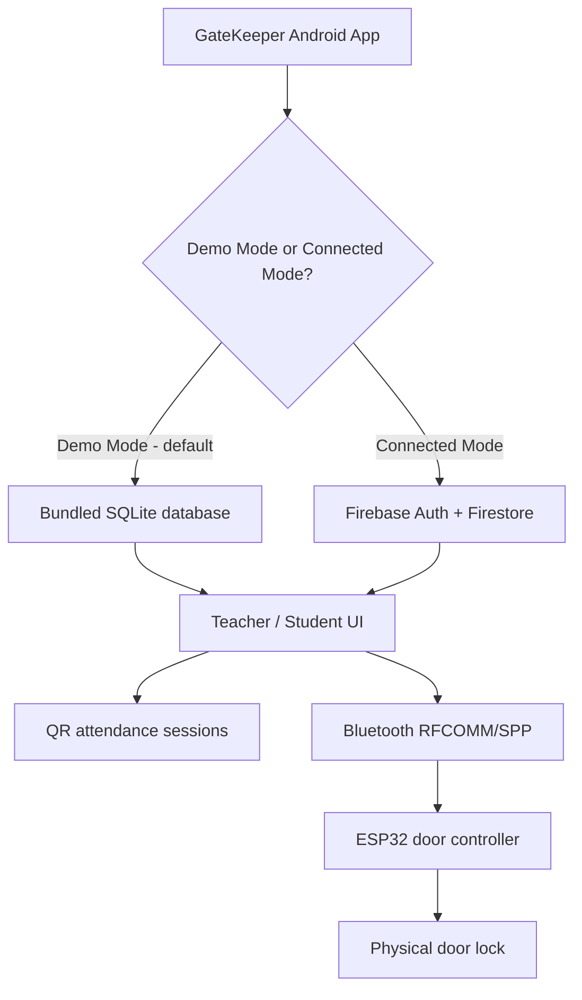

Demo Mode never touches Firebase or hardware — everything runs against the bundled SQLite database, fully offline. Connected Mode swaps in Firebase for auth/sync and a paired ESP32 for real door control. The attendance and UI logic is shared between both.

## Project structure

```text
GateKeeper/
├── app/
│   ├── src/main/java/com/sdstiwi/gatekeeper/
│   │   ├── LoginActivity.java
│   │   ├── RegisterActivity.java
│   │   ├── TeacherDashboard.java
│   │   ├── StudentDashboard.java
│   │   ├── DatabaseHelper.java      # opens/migrates SQLite, delegates to the DAOs
│   │   ├── UserDao.java, ClassDao.java, EnrollmentDao.java, AttendanceDao.java,
│   │   │   NotificationDao.java, SessionDao.java, RoomDao.java, QrCodeDao.java
│   │   ├── SessionManager.java
│   │   ├── BluetoothHelper.java
│   │   ├── DemoConfig.java
│   │   └── ...
│   ├── src/main/res/
│   ├── src/main/assets/SmartClassroom.db
│   └── google-services.json.example
├── docs/
│   ├── screenshots/
│   └── demo.gif
├── .github/workflows/android.yml
├── build.gradle
├── settings.gradle
├── gradlew
├── gradlew.bat
├── LICENSE
└── README.md
```

## Attendance and QR rules

One consistent path for every check-in:

```text
Student check-in
      ↓
Validate enrolled student
      ↓
Validate active session
      ↓
Validate QR creation/expiry
      ↓
Reject duplicate student + session
      ↓
Record one attendance entry
```

A session only counts as active if attendance is enabled for it and the current time falls between its start and end. QR expiry is checked on its own, separately from session activity. Timestamps are stored as epoch milliseconds everywhere; timezone conversion happens only at display time.

The database also enforces uniqueness on:

- `student + session` attendance records
- `student + class` enrollment requests
- user email addresses

## Demo mode vs hardware mode

Set in `DemoConfig.java`, Demo Mode is on by default.

| Operation | Demo Mode | Hardware Mode |
|---|---|---|
| Attendance | Recorded in local SQLite | Same attendance workflow |
| Door unlock/lock | Simulated | Sent to ESP32 over Bluetooth RFCOMM/SPP |
| ESP32 required | No | Yes |
| Bluetooth address | Not used | Set locally via `DemoConfig.ESP32_DEVICE_ADDRESS` |

Hardware mode only reports a door action as successful once the Bluetooth write actually succeeds — a failed connection is never shown as a win.

## Time handling

No manual timezone math (no `+3600000` style offsets) — everything is stored as epoch milliseconds via `System.currentTimeMillis()`, which sidesteps a whole class of device-timezone bugs around session/QR expiry. There's also a migration path in the database for older sessions/QR codes that were stored as text timestamps before this.

## Prototype limitations

This is an academic prototype. The public demo intentionally leans on local SQLite and throwaway demo credentials — a real deployment would need proper auth/password storage, authenticated hardware commands, server-side authorization, encrypted transport, and real database security rules.

## Testing

The repository currently includes basic unit/instrumentation test scaffolding; it does not yet provide comprehensive automated coverage of the core workflows. Treat the test suite as a starting point, not evidence of production-level verification. Run the available checks with:

```text
app/src/test/
app/src/androidTest/
```

```bash
./gradlew test assembleDebug
```

GitHub Actions runs the available unit tests and builds the debug APK on every push and pull request. The workflow also uploads the APK as a build artifact.

## UI

Card-based layout throughout — schedule cards, room status badges, activity notifications, a dedicated QR attendance flow. Demo data is seeded at startup so the main screens are already populated the first time you open the app, instead of staring at empty states.

## Project context

I built this while digging into attendance automation, QR validation, local data handling, and smart-door interaction, all in one project. The app, the database layer, the sync layer, and the hardware communication are kept separate on purpose, so there's a real path from "portfolio demo" to an actual connected deployment if I ever take it further.

## License

MIT — see [LICENSE](LICENSE).

## Repository policies

- [Contributing](CONTRIBUTING.md)
- [Security policy](SECURITY.md)
