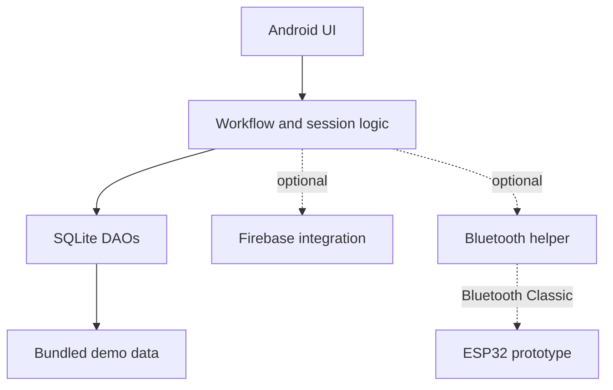

# Architecture Overview

GateKeeper is a Java-based Android application organized around Activities, Fragments, data-access objects (DAOs), local SQLite persistence, and optional service integrations.

## Main components

- **Presentation:** login/registration activities, teacher and student dashboards, and feature-specific fragments.
- **Local persistence:** `DatabaseHelper` initializes and manages the SQLite database; DAOs encapsulate access to users, classes, enrollment, attendance, sessions, notifications, rooms, and QR data.
- **Session and workflow logic:** `SessionManager` and related helpers coordinate app/session state and attendance flows.
- **Optional cloud integration:** Firebase helper and sync classes provide integration points for authentication and cloud data synchronization when configured.
- **Optional hardware integration:** `BluetoothHelper` communicates with a paired ESP32 over Bluetooth Classic in hardware mode.
- **Demo experience:** bundled sample database and demo configuration allow exploration without a Firebase project or physical controller.

## Demo and connected configurations

The repository documents Demo Mode as the default. In this mode, sample data is stored locally and door actions are simulated. Connected-mode integrations require the developer's own Firebase configuration and compatible hardware setup.

## Important limitations

This diagram describes the project's integration boundaries, not a security architecture. Demo credentials are not suitable for real accounts, and the current Bluetooth command protocol must not be used to protect real doors. See [Security Policy](../SECURITY.md) and the security section in the main README before adapting the project.
